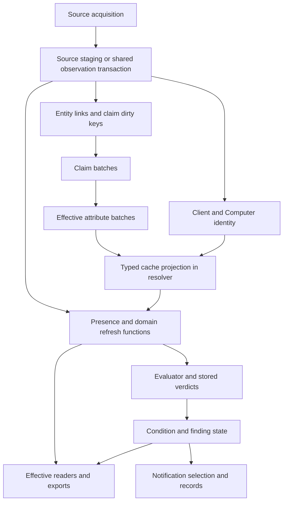

# PLAN-017 — Initial local static assessment

Current synthesis: [completed Phase 1 author assessment](PLAN-017-phase-1-assessment.md),
including A/B/B2 and Claude C results, U02/U04 dispositions and all coverage
routes. This initial-batch record and its original evidence remain historical
inputs. Independent whole-gate acceptance remains separate.

Date: 2026-10-25. Status: Phase 1 in progress, first assessment batch.
Authority: the user adopted the [consolidated charter](../plans/PLAN-017-consolidated-data-architecture-review-draft.md)
and authorized local static assessment. PLAN-017 survives; PLAN-018 is
superseded. This record is evidence, not a new architecture authority.
No production access, application execution, containers, experiments, migrations,
runtime edits, commits, pushes, or deployment were performed for this assessment.
Phases 2–5 have not been executed. The Phase 1 exit gate is **not met**:
object-by-object reconciliation and exception/consumer tracing remain open.

Claude round 14 amendments and the [second static batch](PLAN-017-static-assessment-batch-2.md)
are now recorded. F01 is narrowed, F04 explicitly records the contract
contradiction, and F05 is split into F05a/F05b. The second batch adds a forward
declaration/ORM/index/trigger inventory, first-identity publication order,
five-platform fetcher matrix, source-guard premise correction, and conditional
software publication finding F06. The original evidence folder is unchanged.

Claude round 15 accepts the C2 correction and F06, confirms C1/C3–C6, and
keeps U02 unresolved. Two R09/R11 leads are now explicit: the source writer's
`_record_source_run` docstring still says its receipt serves the evaluator
source guard (documentation drift), and `successful_run_available` in
`condition_evidence.py` has no discovered callers at the pinned source. Older
SQL source-health/lifecycle definitions still mention run logs. Reconcile their
current forward definitions and actual consumers before claiming the
`ok=True, rows=0` source receipt is consumed or unused. Do not change the
runtime docstring or retire the helper/log under this assessment authorization.

The [third static batch](PLAN-017-static-assessment-batch-3.md) now corroborates
that drift and finds no static helper callers. It traces the expected forward
source-health matview to `source.*` receipts and current UI consumers, while
the evaluator guard remains on durable Jobs/output records. It also follows
zero-row completion through SQL 0263, refines F06's recovery by publication
stage, records configuration/time mechanisms and previous-state rebuild inputs,
and adds unresolved target-consumption interleaving lead U04. U02 remains
unresolved. None of these local traces establishes deployed behavior.

After Claude round 16, F01 explicitly includes its local operator-visible
false-healthy source-health path. The [catalog/lifecycle checkpoint](PLAN-017-catalog-lifecycle.md)
and [Phase 1 gate candidate](PLAN-017-phase-1-gate.md) now consolidate the
remaining destinations, add F07's clean-catalog-rebuild contract mismatch, and
link the [exact D1–D5 query/role drafts](PLAN-017-diagnostic-queries.md).
This is a gate **review candidate**, not acceptance or authorization. Runtime
roles, costs, installed definitions and queries remain unverified; Claude's
review and any required static amendments come before any approval request.

## Baseline and checkpoint reconciliation

- The delivered charter SHA-256 was
  `3f1e29317e977a9486c98f0c1f75a5f1328c813699b9b7c508c8c60a730ac95e`, matching
  debate Point 35. Claude's rounds 12–13 and R1–R8 dispositions are present.
  Adoption changes status/routing, not the acceptance scope.
- Original PLAN-017 source SHA-256:
  `ae4572e93ee85eeb5fd25c8940e6429d9825f40a488e83e1dde6f76b99de0ce4`.
  Original PLAN-018 source SHA-256:
  `7119d697e625daf68e873b621fe622025d2eff71c75abb4b3f778dcdfd8700ca`.
  Both original texts remain unchanged, with lifecycle routing in the registry.
- Initial HEAD was `8a33233e0cb5c54548842f221f74c5fdc8c3f666` on `master`.
  Concurrent work advanced HEAD before inventory capture to
  `be55a725cf815fed56156661c364eb9d4f16b64c`. The inventory pins that HEAD and
  the actual local file bytes, including dirty/untracked source. Subsequent
  HEAD movement was observed; a digest recheck is required at every resumption.
  No commit or staged change is attributed to this review.
  The [closing recheck](PLAN-017/checkpoint-recheck.json) records HEAD
  `0c812db74e9a398fbe1f32a80db85c69f216f023` and zero changed/missing pinned
  source or original-plan files. Git commits changed their status, while their
  inventory bytes stayed identical. Source hashes, rather than dirty labels,
  are the corroboration used for this batch's findings.
- The prior checkpoint's draft and source preservation claims corroborate.
  Its statement that execution had not started was correct before this user
  instruction. Its `ready` statuses and adoption gate are now superseded by
  the user's adoption and registry update.
- Existing work includes identity matching, client promotion/moves/domains,
  merge/split UI and tests, inventory readers/templates, and governance/handoffs.
  These are observations of Git/files, not permission to complete, discard,
  stage, or release that work. Prior PLAN-012 production timings remain dated
  evidence from 2026-10-23; no current deployed version or population is known.

The pinned [source manifest](PLAN-017/source-baseline.json) contains 949 files:
947 allowed source/packaging files plus the two preserved source plans.
Source files total 171,321 lines. The
[file routing inventory](PLAN-017/file-routing.csv) gives each an initial review
destination. The [object occurrences](PLAN-017/object-occurrences.csv) contain
5,831 lexical SQL operation occurrences and 489 distinct qualified names;
[Python definitions](PLAN-017/python-definitions.csv) contain 3,506 top-level
function/class definitions. These are discovery counts, **not live object,
entrypoint, test-case, or completed-review counts**.

Inventory coverage correction: the preserved builder's qualified-name
allowlist omits the global `catalog` schema. Its 489 names are not a complete
schema inventory. The third batch supplies the catalog declaration families
and routes their lifecycle/consumer audit; the six original evidence files and
builder stay unchanged. Include `catalog` in future diagnostic allowlists.
On the next fresh evidence copy, add `catalog` to the builder's `SCHEMAS`
before generating that copy. Do not hand-adjust counts or edit the original
six-file evidence set to make it appear complete.
This was done for the separate [fresh gate evidence](PLAN-017-gate-evidence/source-baseline.json):
same 949 baseline files, 6,105 lexical occurrences, 506 allowlisted object names
and 3,506 Python definitions. The copied builder differs in its SCHEMAS tuple;
the original builder/evidence remains unchanged. These counts are generated,
not a complete installed object census or proof of dynamic SQL equivalence.

Reproduce discovery with the stdlib-only
[inventory builder](PLAN-017/build_static_inventory.py):

```powershell
python docs/records/PLAN-017/build_static_inventory.py check
# On a fresh evidence copy only; never overwrite the pinned baseline:
python docs/records/PLAN-017/build_static_inventory.py write
```

The builder reads allowlisted local source and invokes read-only Git commands.
It does not import the application, load environment/configuration data files,
read .work, or connect to services. It refuses to overwrite its baseline.
Its lexical scan includes comments, reverse SQL, fixtures, and repeated
definitions; it misses ORM-only names, unqualified index/trigger names,
dynamic identifiers, split string literals, function calls in SELECT, and
imported/generated migration bodies. Top-level definitions are navigation
leads, not reachability. Operations `manage.py`, initialization dispatch,
ORM metadata, dynamic registries, external consumers, and actual catalog
objects need explicit follow-through beyond the generated inventory.

## Review destinations and entrypoints

Counts below are initial routing; cross-cutting dependencies may need more
than one destination. Every routed file remains unreviewed except the sampled
contracts described below. No lexical absence closes a lifecycle/consumer lead.

| ID | Files | Boundary, grain, and main paths | Remaining review destination |
| --- | ---: | --- | --- |
| R01 | 9 | Service/schedule/Jobs publication: ingest main, worker/child, Dockerfiles, Compose, Operations entrypoint | Reconcile registered job definitions, schedule resources/dependencies, child terminal results, startup and manual HTTP dispatch, Django manage/WSGI/ASGI entrypoints and migration races. |
| R02 | 13 | Source acquisition/current evidence: connectors, source writer, observations, snapshot runs; stable identity is tenant + source instance + namespace + parent pair + external ID | Trace each fetcher's completeness, rejection accounting, source-ID reuse, receipt/contact timestamps and scope contract. F01/F02/F03 below. |
| R03 | 9 | Learned identity and authored moves: resolver/matching/naming, client resolver/domains, shared client evidence | Reconcile ADR-0032/0040/0041/0042/0043 and current SQL operations, merge provenance, promotion, moves, split and concurrent work. |
| R04 | 35 | Shared claim/effective/candidate/relationship/OS projections, typed caches, DB helpers and common utilities | Dirty triggers, claim selection, policy/time invalidation, locks, drain bounds, sole-writer privileges and cache replay. F04 below. |
| R05 | 45 | Requirements, condition assessments, finding state, policy and notification records | Evaluation transactions and reconciliation, reference/policy version retention, per-scope authority and duplicate notification-event behavior. |
| R06 | 51 | Software installations, catalog and global intelligence feeds | Per-device completeness/holds, dirty-title processing, corpus versions, catalog/safety/exposure publication, global-reference protection and expiry. |
| R07 | 17 | Native Ninja core, health, patches, activities, legacy agent compliance | Native versus compatibility grain/purpose, all readers and refresh edges; retain PLAN-006 deferral. |
| R08 | 4 | Dedicated retention/backfill/restore entrypoints | Cross-tenant guards, reference protection, cutoff baselines, job bounds, historical reconstruction and withdrawal episodes. Other retention code also lives in SQL/Jobs. |
| R09 | 446 | SQL init/migrations and Django migrations | Reconstruct forward definitions/dependencies; extract ORM declarations, indexes, trigger targets, constraints, grants/RLS and dynamic SQL. Live reconciliation remains gated. |
| R10 | 221 | Test files across shared contracts and domains | Inspect test mechanisms and fixture isolation before proposing bounded experiments; test count here is files. Existing tests are not production prevention. |
| R11 | 97 | Operations readers/admin/APIs/templates/exports and utility scripts | Trace first tenant query through render/stream/CSV, all Computer and Source-record consumers, indirect ORM/SQL and privileged tooling. |

Static packaging evidence: ingest Dockerfile copies `ingest/`, `sql/`, and
`shared/`, and starts `python -m ingest.main`; Compose also starts
`python -m ingest.jobs_worker` from that image. Operations copies apps, config,
templates, shared code, manage.py, and its shell entrypoint. That entrypoint
applies Django migrations before starting Gunicorn. Ingest migrations run
in filename order with a separate transaction per SQL file
([runner](../../ingest/migrations.py#L28)). Cross-service startup order does
not establish migration application or compatibility on any deployed system.
No new runtime file is introduced by this assessment; evidence stays outside
the application source-copy paths.

## Authority and publication map — sampled shared contracts

| Contract | Local source/write authority and readers | Publication/failure boundary and unknowns |
| --- | --- | --- |
| Current source evidence | Fetchers provide normalized/raw dictionaries; shared `write_observations` calls `write_current_rows`; current/history rows feed identity, claims, source views and evaluator | Accepted observations/history are in the caller transaction. Row/advisory locks serialize stable identities; incoming timestamps must be strictly newer. A content/projection/presence transition opens history; a heartbeat still assigns current payload columns. F01 covers the empty caller gap. All direct/SQL writers not yet audited. |
| Snapshot absence | `begin_run` checks binding/tenant and locks tenant/instance/scope; `complete_run` records explicit completeness; reconciliation withdraws current rows and closes history | Reconciliation requires successful complete run, scopes tenant/instance/snapshot, and protects evidence received at/after run start. Current/history mismatch raises. This is a preventive mechanism on this path, not proof all fetchers label completeness correctly. |
| Client and Computer identity | Existing mapping/client scope in shared writer; fast device matching; client then device resolver jobs; recorded mappings/merge actions are learned/authored state | Writer gives new org/device evidence one transaction, but new group creation/attachment and projection can require later resolver jobs. Same-collection S1 visibility is unresolved; mere insertion order proves no parity. |
| Source-derived values | Claim/effective SQL projectors select evidence under definitions/policy; device cache projector reads effective values plus type evidence; typed caches feed `v_device` | Shared refresh has separate committed stages and catches generic projection failures. `busy`, `batch_limit`, `migration_pending` can also return without throwing. Resolver catches typed-cache failures. Cache fallback retains prior values with no selected effective value. F04; R04 owns the remaining rebuild/input gap. |
| Requirements/findings | Evaluator writes findings and `device_requirement_state` in the coverage transaction; migration 0332 replaces a tenant/full-pass or selected-device verdict slice | Scheduled `platform-evaluate` dispatch calls `_platform_evaluate_and_check`, not the logging-only wrapper in main. Consistency checks are separate transactions. Preserve this distinction when assessing L5 and failure semantics. UI applicability copies remain PLAN-014/012 review dependencies. |
| Software | Complete listing stream stages into temporary data and set-based apply; per-device completeness and sharp-shrink holds govern removal | No list for a device preserves its prior installations. Incomplete paging prevents removal. Read-model refresh follows committed acquisition, and only material change triggers it on some paths; F06 in the second batch records the conditional retry/publication gap and durable-target mitigation. Catalog follows title/safety refresh; EOL projection exceptions are logged. |
| Patches/activities | Source-domain writers and stable activity-ID insert-ignore; events also feed source events and software rescan demand | Patch refresh order is explicit. Activities commit evidence, then cursor, then software demand, then summaries. Cap and handoff findings F02/F03. Source facts can publish across multiple transactions. |
| Jobs and queues | Shared registry + SQL Jobs functions + worker/child own admission, claim token, resource scope, heartbeat and terminal transitions | Dispatch/finish functions and recovery-policy registrations are present. Shared registry alone does not prove a run's inner stage result or deployed enabled schedule. Race/replay/claim constraints remain R01/R09. |
| Notification records | Dispatcher selects current actionable assessments, checks rules/suppression/cooldown, records events, then updates cooldown after send | Separate selection/send/event/cooldown boundaries visible. No exactly-once event/retry claim established; scope for this review is record integrity/duplication. Notification-delivery reliability stays excluded. |

The first publication graph is:



Edges describe dependencies, not a single atomic transaction, a proved
execution sequence, or a coherent generation. In particular, resolver cache
work is separate from the shared collection refresh. Read generations,
time-driven invalidation, recovery cursors and success meaning remain to be
reconciled for each edge.

## Materialized views and indexes — discovery checkpoint

There are 29 distinct names at lexical materialized-view CREATE sites,
including historical/reverse/test statements. The full occurrence CSV retains
each definition location. Dynamic refresh lists below were inspected manually
because the lexical scanner cannot resolve their identifiers.

| Declaration leads | Publication/read leads and unresolved work |
| --- | --- |
| `ninja_activities.device_activity_signal`, `patch_warning_events_recent`, `system_reboot_events_recent` | Activities refreshes these three in one transaction via a dynamic list after its cursor/handoff. Trace current downstream SQL and failure retry. |
| `ninja_core.v_active_devices`, `latest_device_health`, `device_troubleshooting_signal` | Device/custom-field, health, and summary refresh sites present. SQL 073 redefines these against generic evidence. Trace all native patch/activity readers, not just application reads. |
| `ninja_patches.current_patch_state`, `latest_install_outcome`, `device_patch_signal`, `device_patch_activity` | Patch writer refreshes this sequence. Audit dependency edges, scope and generations from latest definitions. |
| `ninja_inventory.source_observations_current`, `unresolved_source_records_current`, `devices_current`, `serial_quality_current`, `identity_conflicts_current`, `merge_candidates_current`, `inventory_summary_current` | SQL 063's refresh function orders these seven; `inventory.refresh.refresh_current` calls that function. Reachability, actual consumers, latest object kinds and retirement status unverified. |
| `operations.agent_presence_current` | Historical name renamed by migration 0047. Do not count as a separate live store. |
| `operations.device_agent_presence_current`, `device_session_current`, `device_patching_scope_current`, `client_health_trend_current`, `source_health_current` | Coordinator definition in 0061 calls presence, session, patch scope, trend, health in that order. Later migrations replace/import definitions; migration 0124 drops two `_legacy` matviews, not evidence that current names are unused. Reconstruct effective forward SQL before drawing conclusions. |
| `operations.software_title_current`, `v_software_safety` | Dynamic concurrent refresh per relation, separately committed, then catalog. Native software/classifier/UI readers remain to trace. |
| `operations.device_software_exposure_current` | Refresh after software classification; migration SQL 112/114. Reader/filter/approval contract independent of Computer list. |
| `operations.v_device_software_exposure_base`, `v_client_software_issue_rollup`, `v_eol_mapping_candidates` | Historical CREATE leads in SQL 081/083. Follow subsequent SQL migrations and current definitions before assigning present kind, refresh needs, or consumers. |

Index seed corroboration: model declarations include
`idx_obs_current_observed(tenant, observed_at)` and
`idx_obs_current_active(tenant, active, entity_type)`
([models](../../operations/apps/core/models.py#L3389)). Current
Source-record reader SQL orders by `last_seen_at DESC NULLS LAST,
observation_id` ([reader](../../operations/apps/core/views.py), `source_records`).
The model declaration does not establish the live index set or cost.
PLAN-012's dated timings justify investigation, not a new approved index.
Unqualified SQL indexes, ORM indexes/constraints and indirect writers remain
R09 work. For each, retain enforcing/reader purpose, exact definition, update
sensitivity, and then size/usage/reset/window when authorized. No index
retirement or physical bloat claim is made from local assignments/searches.

## Initial lifecycle and retention matrix

All horizons, enforcement schedules and references below need verification;
the configured closed-history default is not a universal undo/raw policy.

| Dataset class and retained unit | Local mechanism/clock and purpose | Open dependency/verification |
| --- | --- | --- |
| Current/withdrawn source row | Stable identity, latest raw/canonical payload, observed/receipt/withdrawal metadata; absence marks inactive rather than deleting | Reappearance overwrites latest withdrawal marker; trace action/history/run evidence for earlier episodes. No original transport-byte fidelity established. |
| Material source history interval | Material/projection/presence transition; closes at observation/withdrawal boundary | Raw changes without material transition are not a complete raw-version archive. Equal/older observations are skipped. Cutoff history supports only retained intervals, not every receipt. |
| Software installation current/history | Device/product/version/path-specific inventory and SCD intervals; stale/removal and shrink holds | Reconcile precise unique key, dedup grain, retained raw fields, device moves, references and released holds. |
| Claims/effective/member/support/conflict state | Dirty-key SQL projection; closed claim history purged by guarded function | Policy/code/reference versions and prior typed-cache fallback inputs needed for reconstruction are not yet proven retained. |
| Daily observed presence | One source-record/UTC-day row, insert-on-conflict no-op | Daily evidence is not continuous presence. References and retention for daily population remain unresolved. |
| Learned anchors/source memberships | Client/Computer identity and link history persist beyond quiet sources | Inverse-action/merge provenance protection, cascading FKs and client offboarding must be inventoried. |
| Authored mapping/operator decisions | Recorded mappings, aliases, overrides, exclusions, exemptions and software decisions | Replay must preserve decisions. Moves are recorded, but not all automated actions promise identical reversal semantics. |
| Change actions/history | Action and per-object changes; merge/split provenance | ADR-0032 preserves memberships/inverse provenance, not full intervening rollback; ADR-0040 records movable mappings. No expiry in those guarantees. Trace FKs and purge protection. |
| Policy/reference versions | Condition policy immutable versions/digest; global software/intel reference data | Digest/version label is not executable processing history. Source/corpus historical availability and configuration snapshots unresolved. |
| Findings/condition assessments | Findings include operator state; assessment participant/policy/freshness contracts | Not a disposable evaluator cache. Retain acknowledgement/snooze and dedup state across rebuild, merge and expiry. |
| Immutable source events/activities | Source IDs deduplicate events; activities use native ID PK | F02 cap and F03 discarded software triggers constrain replay. Event retention and ID reuse/tenant grain require audit. |
| Rejected/dead-letter input | `dead_letter_observations` model exists | Writer coverage and rejected/malformed accounting not established; model existence is not enforcement. |
| Run/receipt bookkeeping | Snapshot runs keep counts and identity digest; Jobs runs/events/heartbeats and source run logs have distinct grains | Digest cannot reconstruct membership or payload. Establish references, clocks, schedules and replay guard lifetimes separately. |
| Queues/source actions | Pending/running/terminal requests, leases and retry metadata | Determine disposal of terminal rows versus dedup/replay protection; no queue action authorized. |
| Derived views/caches/rollups | Native and generic read models rebuilt through separate functions | Rebuild order and cache fallback inputs unresolved; retaining less input can change rebuilt output. |
| Legacy/native snapshots and compliance history | Named retained snapshots/backfills and append writers remain searchable | Normal Ninja paths have tests excluding legacy snapshot writes; legacy compliance has explicit history/event writers. No general active-growth or cleanup-absence conclusion. |
| Notification event/cooldown records | Event receipt after attempted delivery; separate successful-send cooldown update | Replay can create legitimate attempts; duplicates and cooldown semantics need scoped tracing, without broad delivery redesign. |

L8's fourteen candidates all have R08/R09 destinations: `ninja_core.run_log`,
`device_snapshots`, `device_health_snapshots`; `ninja_activities.activities`;
`operations.source_record_seen_daily`, `change_actions`, `operator_job_runs`,
`operator_job_events`, `job_runtime_heartbeats`, `observation_snapshot_runs`,
`source_action_requests`, `source_run_queue`; and
`ninja_agent_compliance.alert_events`, `compliance_matrix_history`.
Writers for runs, daily presence and legacy compliance are found. Dynamic queue
table constants and SQL triggers require indirect inspection. External cleanup,
active rates and current storage are unknown for all fourteen.

## Findings — local mechanisms, with impact still to verify

All findings have deployment scope **local baseline only**. Severity is
conditional engineering impact, not a measured incident. Likelihood is unknown;
confidence below applies to the stated code path. None authorizes remediation.

### F01 — An empty generic collection skips absence reconciliation

- Contract/criteria: R02; A2/A3; S3/S4. Grade: code-confirmed. Conditional
  severity: High if an authoritative complete-empty response occurs with prior
  active records; confidence: high in the local mechanism.
- Evidence: [shared writer](../../ingest/source_observations.py#L249) returns
  immediately on `not rows`, before `begin_run`, `complete_run` or
  `reconcile_complete_run`. The caller records successful source collection
  with the returned zero. Existing run primitive tests explicitly support
  zero-row complete-run reconciliation; the outer writer does not reach it.
  There are two executable caller sites: `run_source_observations` and Ninja
  devices. Ninja appends organization container rows whenever an organization
  exists, so a zero-device population alone does not exercise this early
  return. F01's fetcher audit is narrowed to `_FETCHERS`: SentinelOne,
  ScreenConnect, LogMeIn, R-U-ON and Hudu. A wholly organization-free Ninja
  input is a separate boundary case, not an assumed deployed exposure.
- Affected consumers: source active/presence state, downstream claims, identity
  evidence, coverage and source health. Prior evidence can remain active when
  a real complete-empty response should withdraw it.
  **Operator-visible consumer (Claude round 16, local code-confirmed):**
  `source_health_current` in migration 0077, imported by 0098, reads
  `source.*` run-log rows including the `ok` subset. An empty `_FETCHERS`
  result recorded as `ok=True, rows=0` can therefore show a healthy source on
  Dashboard, client workspace, Patching and Admin readers. This false-healthy
  path is distinct from durable job success and from the evaluator guard;
  its grade is local-only pending installed-definition and runtime checks.
  Observation-age predicates can still flag staleness on some readers, so
  this does not assert that every such page always shows healthy.
  `run_source_observations` records the empty fetch as `ok=True, rows=0`
  ([caller](../../ingest/source_observations.py#L134)). **C2 premise correction:**
  at the pinned source, `_source_failure_guard` calls
  `source_health.collection_problems`, which reads `operator_job_runs` and
  `source_refresh_outputs`, not `operations.run_log`. The evaluator's own
  `run_log` reference writes its evaluation receipt. The false-success receipt
  is confirmed; the claimed direct read by the current guard is contradicted.
  A permission-limited empty fetch can also finish the durable `source-refresh`
  path successfully because this path raises no completeness error; that
  terminal/output contract, rather than a direct run-log dependency, is the
  source-guard exposure to verify.
  The third batch traces the completed output insertion through SQL 0263:
  zero rows are allowed and no complete-snapshot/projector-status assertion is
  required. It also confirms expected local UI consumers through the source-
  health matview. Those consumers are distinct from the evaluator guard, and
  observation-age checks may still show stale evidence despite a success receipt.
- Competing explanation/limits: some fetchers emit container-only rows, so an
  empty device population can still yield nonempty input. Empty results can
  also mean failure/permission limitation; blindly treating every empty list
  as complete would be unsafe. No affected deployed source/run is established.
- Options/dependencies: explicit acquisition result carrying completeness and
  accounting, with a successful complete-empty transaction; preserve prior
  evidence on ambiguous empty/partial results. Reproduce bounded complete,
  partial and failed empty responses at the actual writer, not only the SQL
  primitive. Proposed routing: PLAN-002/007 after approved scope; R02 owns
  verification for the five `_FETCHERS` platforms and their empty/container
  behavior; Ninja container publication is tracked separately under S1/R03.
  See the [second-batch trace](PLAN-017-static-assessment-batch-2.md) for the
  narrowed connector matrix and the C2 source-health correction.

### F02 — Activity cap advances the high-water mark past unread events

- Contract/criteria: R07; A2/A7; S3/S8/S13. Grade: code-confirmed conditional
  skip path. Conditional severity: High; likelihood unknown; confidence high.
- Evidence: [_pull_one](../../ingest/activities/ingest.py#L180) walks newest
  first with `olderThan`, carries the highest seen ID, logs at the 200-page cap,
  and returns no incomplete marker. [run](../../ingest/activities/ingest.py#L165)
  then persists `max_id`. On a backlog deeper than the cap, an unread older
  page still above the old cursor is below the new cursor and the next run
  stops before it. Nonadvancing-pagination exit has the same completeness gap.
- Affected consumers: source deletion events, native activity/patch contextual
  signals and software refresh demand. This is not a claim that such a backlog
  has occurred. First-run no-backfill is an explicit separate contract.
- Competing explanation/limits: configured filters and source volumes may keep
  every run below the cap; a deliberate lossy history policy could be chosen,
  but the current path does not expose that as incomplete publication.
- Options/dependencies: durable per-filter pagination/catch-up frontier, or
  withhold committed high-water advancement until all required streams cross
  the old frontier, with bounded continued drains. Compare shared-cursor and
  per-stream state and outage costs. Verify with a tiny synthetic page cap and
  two filter streams in Phase 2. Proposed owner: PLAN-002/007, scope approval
  required; retain PLAN-005 terminal-success implications.

### F03 — Cursor commit precedes durable software-trigger handoff

- Contract/criteria: R07/R06; A2/A4; S8/S10. Grade: code-confirmed failure
  window. Conditional severity: Medium; likelihood unknown; confidence high.
- Evidence: [activities run](../../ingest/activities/ingest.py#L143) excludes
  software trigger events from native durable activities. It commits storable
  rows/source events, commits the high-water cursor via `_set_last_id`, then
  calls `_enqueue_software_activities`. Failure between cursor commit and
  enqueue prevents this path replaying those trigger IDs.
- Affected consumers: event-driven software collection and ingest-to-visible
  lag. The scheduled full-fleet software check is an explicit recovery
  alternative, so this is not proof of permanent installation loss. Generic
  event capture is present; whether it can independently regenerate the
  rescan demand remains unresolved.
  `source_events.capture_ninja_events` does retain eligible software events as
  generic events when its schema/source-instance prerequisites succeed; native
  activity discard therefore does not imply all raw trigger evidence is lost.
- Options/dependencies: atomic durable demand/outbox plus cursor, or a tested
  recovery path from retained events; compare with accepted fleet-check delay.
  Trace `capture_ninja_events`, queue dedup and successor workflow before
  selecting a design. Verification: inject a synthetic enqueue failure at the
  boundary. Proposed routing: software collection/Jobs owners PLAN-002/007/005;
  do not reopen completed PLAN-011 without new scope.

### F04 — Documented publication contract contradicts swallowed projection failures

- Contract/criteria: R04/R01; A1/A4/A10; S8/S9/S10. Grade: code-confirmed
  existing PLAN-012 lead, re-corroborated. Conditional severity: High for
  materially stale authoritative fields; likelihood unknown; confidence high
  for swallowed/returned stage states, unverified for result impact.
- Evidence: [shared refresh](../../ingest/derived.py#L19) catches claim,
  effective, candidate, OS and relationship projector exceptions and continues
  to `operations.refresh_derived()`. [claim](../../ingest/attribute_claims.py#L13)
  and [effective](../../ingest/effective_attributes.py#L13) drains can return
  `busy`, `batch_limit` or `migration_pending`; the caller does not require
  `complete`. [resolver](../../ingest/identity/resolver.py#L179) catches cache
  projection failure. The typed [cache projector](../../ingest/device_cache_projector.py#L65)
  reads effective attributes plus entity/type evidence and keeps prior cache
  values when no selected value exists.
  The function's [docstring](../../ingest/derived.py#L23) explicitly says
  exceptions propagate and callers must not report scheduled/on-demand
  collection complete while dependent current state is stale. Its body
  swallows five projector failures. This is a contradiction between the
  documented contract and behavior, also relevant to the main, durable Jobs
  source-refresh, and source-run-queue call sites. Shadow-rollout comments
  explain the behavior's intent without resolving that contradiction.
- Affected consumers: typed Computer fields, downstream facets and effective
  readers. Competing explanation: comments preserve an intentional shadow
  rollout/failure isolation; asynchronous convergence may be acceptable, but
  typed consumers already depend on effective inputs. No one-cycle-lag or
  live stale-value incident is established.
- Options/dependencies: promote stages with explicit success/freshness and
  recoverable demand, or declare and surface asynchronous publication with
  reader freshness semantics. Do not simply make every exception fatal before
  rollout/compatibility design. Deciding whether the documented contract or
  current failure-isolation behavior is correct is part of resolving F04;
  neither is silently selected here. Owner: PLAN-012 item 4; R04 traces the latest
  SQL/privileges and new-client/new-Computer order first.

### F05a — Unbatched observation/software purge shares one transaction

- Contract/criteria: R08; A6/A7; S14. Grade: code-confirmed structure;
  contention/WAL impact suspected only. Conditional severity: Medium for
  concurrent writer/read latency; likelihood unknown; confidence high in the
  transaction and SQL shape.
- Evidence: [purge_all](../../ingest/retention_observations.py#L23) invokes
  migration 0074's two unbatched closed-interval DELETEs in one transaction.
- Affected consumers: concurrent acquisition/reads and maintenance capacity;
  the open risks are transaction lock span and concentrated WAL generation,
  not a measured lock delay, WAL burst, deletion loss, or missed expiry. SQL restricts
  deletion to closed intervals older than cutoff; this does not itself prove
  reference/undo/replay protection across other stores.
- Options/dependencies: separate bounded deletion transactions with a stable
  cutoff/resume contract, or retain the atomic full sweep if measured lock/WAL
  cost fits an agreed budget. Review
  references/cutoff baselines before proposing any retention change. Owner:
  PLAN-017 design/triage, with later separately approved maintenance scope.

### F05b — Claim purge has no whole-job duration bound

- Contract/criteria: R08; A7; S13/S14. Grade: code-confirmed structure; total
  overrun unverified. Conditional severity: Low for maintenance-job occupation
  absent evidence of missed service obligations; likelihood unknown;
  confidence high in the Python loop and SQL batch mechanism.
- Evidence: `purge_claim_history` commits each batch, loops until a short
  batch, and specifies no total elapsed-time or batch-count ceiling. Migration
  0103's guarded function caps each batch and uses `FOR UPDATE SKIP LOCKED`.
  It does not hold one transaction open across all batches. This finding does
  not inherit F05a's unbatched lock-span/WAL-burst claim.
- Affected consumers: the maintenance worker/job capacity if an eligible
  backlog takes a long time; actual duration and competing capacity demand
  are unknown. Short batches/locked rows may also defer work; eligibility
  reconciliation belongs to the broader R08 audit rather than an overrun claim.
- Options/dependencies: retain the drain-until-short loop if measured duration
  fits the maintenance budget, or add a total time/batch budget and schedule
  resumable continuations. Preserve the per-batch commit and skip-locked
  behavior. Verify duration/backlog/next-run behavior separately from F05a's
  transaction cost. Proposed owner: PLAN-017 design/triage, later separately
  approved maintenance scope.

### F07 — Catalog clean-rebuild contract omits persistent reference identity

The [full finding](PLAN-017-catalog-lifecycle.md#f07--catalog-clean-rebuild-description-omits-durable-reference-identity)
records the code-confirmed difference between safe in-place catalog projection
and the stronger claim that dropping/rebuilding from current installations
recreates identical state. Retained products, generated subject UUIDs and
authored/global-reference dependents are additional inputs. Conditional
severity Medium if the claim drives disposal/recovery; no normal-upsert loss
or destructive reconstruction is demonstrated. R06/R08 own verification and
options. Claude round 17 accepted F07; whole-gate coverage and amended diagnostic
review remain separate. No runtime change authorized.

## Acceptance, scenarios, and seed-lead coverage

No A1–A10 criterion is globally satisfied by this first batch. All are unknown
at platform scope; local evidence establishes mechanisms and conditional
violations for particular paths only.

| Criterion | Initial disposition and next evidence |
| --- | --- |
| A1 | Unknown; shared projector/typed-cache authority conflict F04. Complete sole-writer/privilege and precedence map. |
| A2 | Conditional violations F01/F02/F03; shared timestamp/lock/dedup safeguards present. Trace rejection/partial contracts per fetcher. |
| A3 | Partial local withdrawal safeguards; complete-empty gap and repeated-episode history unresolved. Trace reappearance/moves/undo. |
| A4 | Unknown; retained raw/material and authored identity differ. Prove clean/current/corrected/published-at-T rebuild inputs separately. |
| A5 | Unknown; material SCD/daily presence are not full raw/receipt history. Establish historical questions and reference/code/policy availability. |
| A6 | Unknown; closed-interval guard exists, protected-reference and replay lifetimes unproved. Reconcile every disposal path. |
| A7 | Unknown; static cap/drain/purge structures only. No current rows, widths, rates, requests, refresh/WAL/lock costs measured. |
| A8 | Unknown; no replacement selected. Preserve existing owners, decisions and readers, then propose compatibility/parity gates. |
| A9 | Sampled tenant/binding checks, SQL predicates and tenant middleware; global scope not verified. Inspect composite FKs, privileges, maintenance and streaming/export context. |
| A10 | Heartbeat/current assignments, full verdict replacement and parallel projections are code leads. Establish unique purposes and total measured costs before simplifying. |

| Scenario | Static trace status; unresolved next action |
| --- | --- |
| S1 | Priority trace started: shared writer writes org/device evidence together, but new client attachment and typed projection depend on resolver order. Trace R03/R04 generation and first visible values. |
| S2 | Mapping ladder and ADR-0040/0041 read; rename/remap/exclusion/source-ID reuse and shared binding identity remain R02/R03. |
| S3 | Priority trace: F01/F02; shared run gates and Hudu cap exception found; software incomplete paging prevents removal. Audit all connector contracts and malformed/rejected accounting. |
| S4 | Shared absence marks evidence inactive and closes history; source silence does not equal successful complete absence. Trace per-source stale guards and surviving evidence. |
| S5 | Priority trace: ADR-0032 split restores merge memberships/provenance; later history remains where written. SQL/action references and dirty concurrent changes remain R03/R09. |
| S6 | Unresolved: inspect Hudu archived/relayed evidence, VM parent identity, and missing-parent references before domain conclusions. |
| S7 | Strictly-newer observed-time guard traced; Ninja contact differs from receipt, R-U-ON contact intentionally absent. Clock skew, correction and source-specific time quality remain R02. |
| S8 | Priority trace: shared observation/history transaction versus cursor/handoff and projection commits; F02/F03/F04. Replay and A → B → A after expiry remain R08/Phase 2. |
| S9 | Priority trace: stable-identity/snapshot locks, deterministic ordering and claim tokens found; overlapping manual moves/collectors and queue coalescing remain R01/R03/R09. |
| S10 | Priority trace: F03/F04 and software post-commit publication; ordinary collection wrappers aggregate required failures. Trace job result/success/freshness for each actual dispatch path. |
| S11 | Priority trace started: policy freshness and scheduled evaluation visible; dirty-trigger/time/reference invalidation coverage remains R04/R05/R06. Raw equality cannot stand in for it. |
| S12 | Priority trace started: binding/tenant guard and tenant middleware found; reader tenant predicates, global-reference links and move propagation require full constraint/role trace. |
| S13 | Cap/catch-up risk F02 identified. Throttling, saturation, queue recovery and outage arrival/drain rates remain R01/R02 plus later measurement. |
| S14 | Closed-history and batch mechanisms traced; references, time-cutoff baseline, offboarding and concurrent replay/disposal remain R08/R09. |

| Seed | Disposition in this batch |
| --- | --- |
| L1 | Tenant-1/binding constants corroborated in main, shared writer and software path. Configuration duplication or wrong-tenant impact unverified; R02/R03/R09. |
| L2 | Native domains still have purpose/refresh paths; generic and typed copies present. No redundancy/retirement conclusion; R04/R07/R11. |
| L3 | Accepted newer observations update raw/canonical current columns even without new material history. Physical cost unverified; R02/R09 and diagnostic D2. |
| L4 | Model ordering declaration and Source-record reader sort corroborated; current catalog/use/write cost unverified. PLAN-012 owns index proposal. |
| L5 | Full evaluator/verdict replacement mechanism corroborated. Actual durable Jobs dispatcher bypasses logging-only main wrapper; preserve verdict/finding transaction and due-time work. |
| L6 | Refresh statements/lists present; initial graph above. Actual live definitions/cost/generations remain R07/R09. |
| L7 | Daily presence dedup/UTC-day writer corroborated; growth, cutoff and references unverified; R08. |
| L8 | Fourteen candidate stores routed; writer/cleanup/reference/schedule audit incomplete. No unbounded-growth finding. |
| L9 | F05a (unbatched transaction) and F05b (claim-job duration); closed-history guards differ from undo guarantees. No contention/WAL/duration impact measured. |
| L10 | F02/F03 deepen cap/cursor and postcursor handoff leads; deployed backlog/impact unknown. |
| L11 | Latest-health matview declared/redefined/refreshed; indirect reader audit still required, R07/R09. |
| L12 | Latest withdrawal markers retained on current row; prior episodes and action retention unresolved, R08/R03. |
| L13 | Legacy compliance history/event writer leads remain; active schedules/consumers/cost unknown. Preserve deferred PLAN-006 boundary. |
| L14 | Scratch bloat diagnostic was not executed or used as authority. Durable proposal below avoids copying unreviewed scratch SQL. Review/sanitize any reused diagnostic before Phase 3. |

## Existing constraints/tests and verification limits

Inspected observation model declarations show stable-identity uniqueness and
nonempty/paired parent-identity checks; history has an open-interval uniqueness
constraint. Writer row/advisory locks, timestamp guards and caller transactions
provide additional prevention on that path. Binding/tenant lookup guards run
admission; reconciliation checks current/history counts. This is not yet a
complete FK, overlap, null, RLS, grant, trigger, or all-writer audit.

Existing test sources inspected: `test_observation_runs.py` checks
binding/tenant, explicit completeness and reconciliation SQL; the opt-in
`test_observation_dual_write_postgres.py` covers current/history/run behavior,
zero-row reconciliation, reappearance, projection-version changes, daily
presence and overlapping snapshot locks. Its fixture uses a synthetic
`postgres:16-alpine` testcontainer, guarded by `RUN_POSTGRES_INTEGRATION_TESTS`.
These tests do not prove the outer writer handles an empty fetch result.
The source-failure test isolates one fetch failure and then reports aggregate
failure, but replaces the outer writer with a stub. Software apply tests name
stalled/early-empty pagination, shrink holds, completeness-gated removals,
per-device reads and duplicate-last-row handling. Retention tests verify routing
to the guarded function and cutoff arguments; they do not establish whole-job
budget, referential protection or actual SQL deletion behavior. Condition safety,
worker scope/replay/drain and Computer reads remain next-batch test leads.
No application test was run or new application test added in Phase 1.

Documentation authorities conflict on reporting: root requirements still name
Metabase as a reporting destination, while root architecture/registry record
retirement and Operations readers exist. This is documentation drift to route
in final triage; it does not establish a running Metabase consumer or permission
to remove compatibility grants/views. No architecture ADR is changed by these
provisional findings; adopted future design decisions need separate ADRs.

## Bounded aggregate-only diagnostic proposal — not executed

This is a reviewable proposal, not an access request or approved script. Live
access remains prohibited in this session. Before implementation/execution,
read the operations helper guidance and obtain explicit scoped approval for
the chosen batch, role, tenant, target and cost limits. Use local synthetic
checks only after Phase 2 is authorized and fixture isolation is inspected.

| ID | Proposed batch/output | Bounds and exposure | Purpose/limits |
| --- | --- | --- | --- |
| D1 | Deployed version/migration ledger and catalog definitions/dependencies for allowlisted schemas; object kind, index/constraint, function/trigger/RLS/privilege metadata | Read-only transaction; proposed 1 s lock timeout, 5 s statement timeout, 1,000-row page and 10,000-row batch ceiling; no payload, config values, secrets or function data literals in retained outputs | Reconcile local declarations and dynamic edges. Function bodies/grants need careful local handling/redaction; metadata-only summaries retained. Split queries if bounds fail; never silently raise limits. |
| D2 | Existing cumulative table/index statistics and relation/index/TOAST sizes, stats-reset time and exact index definitions for observations/history/claims/daily/Jobs/critical readers | Catalog/statistics only; same proposed timeouts; two snapshots 15–60 minutes apart if separately approved; no reset, extension install, VACUUM or full-table scan | Separate heartbeat key churn from physical evidence. Rates unavailable without valid elapsed/reset windows; table estimates are not exact counts or bloat measurements. |
| D3 | Targeted integrity counts: open-history/current mismatch, orphan reference, tenant/client drift, duplicate stable keys, queue age/status, publication pending/failed stage counts | Review each SELECT/EXPLAIN without ANALYZE first; tenant/known scope and bounded key/time partitions; proposed 5 s statements, 30 s batch wall ceiling; abort/split on timeout | Aggregate results only, no record IDs/names/raw input. Catalog metadata does not prove runtime-role visibility. A bounded sample cannot establish global absence of drift. |
| D4 | Critical reader/stage timings: Computers full fleet/filters/cards/later page/complete CSV; Source records count/choices/rows/CSV separately; distinct software/patch/client/Jobs reader contracts | Prepare exact request/query shapes and cost review first. No ANALYZE, full export, API source call or repeat load included in D1–D3 approval. Propose at most 3 sequential repetitions and explicit export row/byte/time ceilings agreed from size evidence | Record role/tenant, parameters without private values, data-size summary, cache condition and date. Separate DB/transfer/Python/render/full request and ingest-to-visible lag. A capped export cannot validate complete CSV. |
| D5 | Retention/growth/recovery and source-cap incidence: run counts by bounded time/status, oldest/newest completion/closure buckets, estimated widths/rates, logged cap/partial counts | Statistics first; any age/width/count scans require reviewed predicates/plans and D3-style limits; do not read customer payloads or source responses | Feed count/time/hybrid costs and 2×/5× capacity assumptions; no raw retention or undo horizon selected from these statistics alone. |

No D1–D5 query is executable here. Any future expensive EXPLAIN ANALYZE/export
needs its own reviewed bounds. Privileged catalog diagnostics and runtime-role
tenant-scoped request checks answer different questions.

Phase 1 gate requirement (Claude C5, user confirmed): provide exact query text
and a named executing role for each D1–D5 batch, plus explicit D4 request and
export limits. D3 must name its privileged role separately from D4's runtime
role. Claude reviews those exact artifacts before any user approval request.
The shape-only table above does not satisfy that gate and authorizes no access.
The exact draft is now in `PLAN-017-diagnostic-queries.md`, with privileged
`operations_migrate` for D1/D2/D3/D5 and runtime `operations_app` for D4, plus
explicit statement/request/export bounds. Its narrower initial queries and
remaining measurement gaps are explicit. The gate candidate awaits Claude's
review; neither Phase 1 completion nor production/Phase 2 approval is claimed.

## Effort estimate and continuation

Provisional engineering effort based on 947 routed source files, 446 schema
files, 221 test files, 489 lexical object names, 29 matview declaration leads,
14 scenarios, and the 11 review destinations. This is active engineering time,
not a promised completion date; approval delays and environment setup are
excluded. Shared-contract reuse reduces combinations; domain exceptions and
live objects may expand them. Re-estimate after forward-definition inventory.

The first-batch estimate totals **10–22 engineer-days** from remaining Phase 1
through Phase 5. This material scope must be visible before proposing Phase 2;
it is not an approved schedule or a request to authorize later phases now.

| Work | Estimated effort | Coverage assumptions/limits |
| --- | --- | --- |
| Remaining Phase 1 | 3–6 engineer-days | Reconstruct current forward declarations/ORM/trigger/index inventory; audit indirect consumers, configuration/time invalidation and lifecycle references; trace priority scenarios through domain exceptions. Every unresolved item gets a destination and dependent gate. |
| Phase 2 local mechanisms | 2–4 engineer-days | Approximately 8–12 bounded checks reused across contracts: empty/partial, cap/cursor, handoff failure, overlap/replay/A → B → A, policy/time change, move/undo, cutoff expiry/rebuild. Inspect/reuse existing tests; setup/isolation may add effort. Not authorized now. |
| Phase 3 measurements | 1–3 engineer-days | Five reviewed aggregate/cost batches, catalog reconciliation, selected complete request/export coverage. Requires scoped live-read approval and affordable plans; unavailable access leaves explicit gaps. |
| Phase 4 targeted verification | 2–5 engineer-days | Resolve material contradictions and compare 2–3 candidate designs on dominant contracts; measured evidence determines experiments. Runtime changes remain outside review scope. |
| Phase 5 design and triage | 2–4 engineer-days | Coherent authority/publication/lifecycle design, keep/simplify/replace/retire rationale, capacity and count/time/hybrid recovery alternatives, standing checks and ordered owner/routing proposal. No accepted remediation implied. |

The gate ledger now routes the accumulated R01–R11 traces, A1–A10/S1–S14,
all 29 matview CREATE-name leads, and remaining static/dynamic/measurement
unknowns. F07 is accepted in Claude round 17. Next action is independent review
of remaining coverage and G1–G3 amendments to exact
diagnostics, then required local static amendments. Later-phase effort remains
7–16 engineer-days conditional on accepted coverage, plus any remaining Phase 1
amendments; show the reviewed estimate before proposing Phase 2. No elapsed
effort is inferred from turns. Recovery/history questions still wait for costed
alternatives and the charter's consensus gate; none is being asked now.

Commit-time note (C4): keep the existing evidence files unchanged now. If a
commit is proposed later, flag `object-occurrences.csv` and
`python-definitions.csv` as large, regenerable exclusion candidates for the
user's decision. No commit, staging, deletion or exclusion is authorized here.

## Validation checkpoint

Current authority/ownership update (Point 38): Codex owns previously approved
A/B1; new Claude session owns C SQL/HTTP with minimal metrics-only command
review/confirmation. H2 human measurements are superseded; no C manual task
for the user. B2 remains separate. Historical checkpoints below are not a
revocation of earlier explicit A/B1 approval. No diagnostics executed here.

Current continuation (Claude 18 / Codex 16): G1–G5 confirmed; H1 uncapped
platform-only receipt aggregate and H2 private human measurement procedure
applied. A/B1/C [approval request](PLAN-017-approval-request-draft.md) issued,
awaiting explicit selection. B2 must quote actual B1 plan costs/row estimates
and requires its own approval. No access or execution is inferred. Current
HEAD/source digests and original six-file evidence match the previous recheck;
see gate validation for documentation checks. Prior checkpoints below are history.

Latest continuation (Claude 17 / Codex 15): G1–G3 and G4/G5 amendments plus
[approval wording](PLAN-017-approval-request-draft.md) are drafted for review
only. Registry/scoped diff, links/whitespace, nine SQL structural blocks,
15 measured GET shapes/CSV-last/no client binding, HEAD/source recheck and
original evidence hashes passed. PostgreSQL parsing/plans, HTTP/session privacy
execution and production state remain unvalidated. F07 accepted; amended-query
and whole-gate acceptance remain separate. See the gate ledger/latest recheck.

Latest gate-candidate checks: registry (18), scoped diff, Markdown file links/
whitespace, copied-builder catalog-only diff, AST/JSON and all six original
evidence hashes passed. Eight SQL blocks received structural checks only,
not PostgreSQL parsing or execution. Fresh snapshot HEAD is 0c812db; closing
HEAD a3fb9df is a concurrent source-record commit, not created by this review.
Three changed/two added source paths versus the snapshot are recorded in the
separate gate-evidence delta. The builder check correctly returns nonzero for
this drift. Global EOF whitespace is now operations/BLUEPRINT.md:735; the root
size limit remains unresolved. See the gate ledger for the current checkpoint.

The following first-batch checks describe that earlier capture only:

Passed: 18-entry plan registry validation; scoped `git diff --check` for root
BLUEPRINT/registry; local Markdown file targets and line-anchor bounds for the
charter/assessment; whitespace checks including new evidence; inventory-script
AST parsing; CSV row-count reconciliation; original-plan hashes and all 949
pinned file digests unchanged at closing recheck. The script's `check` mode
correctly returns nonzero for changed HEAD even with zero content differences;
the separate recheck records that distinction rather than silently repinning.

Global `git diff --check` still reports the pre-existing unrelated blank line
at EOF in operations/BLUEPRINT.md (now line 718 after concurrent work). Root
BLUEPRINT remains above the governance 4,000-byte cap; it was 33,934 bytes on
entry. This assessment does not reorganize other plans to repair that existing
limit. Those files' other active work is preserved. No Django, pytest, database,
full governance workflow, live catalog, external reader, physical-cost, or runtime
validation is claimed. Phase 1 remains in progress with the next batch above.
