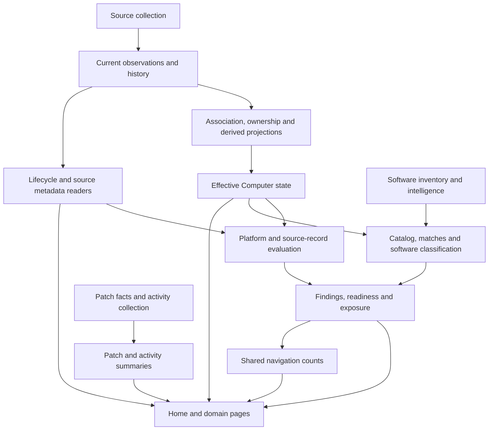

# PLAN-056 — Work shared by pages and Jobs

## Scope, source identity and conclusion

2026-11-10: completed big-picture step 1 at the user's request: map shared
work before choosing remedies. Local source review only; no browser, production
request, Job, test, runtime edit or instrumentation change. This is separate
from the numbered assessment checklist; it does not complete items 6–12.

The platform has several shared paths, rather than one established universal
bottleneck. Pages repeatedly select and aggregate common evidence, while
collection, resolution and classification publish state into those same
domains. The map establishes dependencies and candidate blast radius; it does
not establish that overlapping Jobs caused page latency, or that every consumer
of an expensive relation has the same expensive execution plan.

Git HEAD is `ca00938a`. AST comparison confirmed the reviewed default page
handlers, context processor, Jobs dispatch/refresh functions and relationship
resolver match HEAD. Home differs; Issues selection and Software Home helpers
also retain earlier uncommitted edits. The four-summary Home cache is local,
not a demonstrated deployed improvement. Earlier installed hashes matched
reviewed versions, including views/context before item 5. No fresh deployed
inspection was performed for this map.

## Shared data and work paths

Arrows below are data dependencies, not a claim that every Job always follows
one serial sequence or that requests enqueue these Jobs.

| Shared work | Pages/other readers | Jobs and publication | Established cost and boundary |
| --- | --- | --- | --- |
| **Navigation and action counts**: `brand`, `issue_selection`, active Patching findings and Client roster | All authenticated base-template pages; non-Home renders load the Client roster. Home supplies its Issues badge count; admin pages add three candidate counts. | Platform, source-record, software, patch and identity producers change underlying findings/candidates. No dedicated navigation producer is identified. | Issues selection is governed independent-action logic, not a raw row count. Issues/Patching navigation counts have 60-second tenant-keyed process caches. Synthetic Home Patching-context cold/warm was 0.325/0.000 s; it excludes HTTP/auth/templates. No full-page cost share is established. |
| **Source metadata and record populations**: observation current/history, subject registry, admin metadata and companion classification | Source Records count/facets/page, Home source summary, Sources health/record totals, source detail, client-domain/naming/finding review | Source collection and source-record assessment; association and attribute projections affect effective metadata. | Home inventory reader completed in 1.716 s once; Source Records default page SELECT exceeded its own 3 s limit. Sources record-count statement also exceeded 3 s. They share storage, but health counts, companion-excluded record counts and displayed record populations differ. Metadata JSON/view work cannot be assigned a universal cost from these results. |
| **Source lifecycle policy**: `v_device_source_record_lifecycle_current` | Coverage Hudu population and later source totals; Computer source details; identity matching/findings; evaluator presence checks; `computer_listing` | Resolver/evaluator/listing use the same authoritative policy with different query shapes and scopes. | Coverage's Hudu join has actual repeated broad lifecycle work; full correlated candidate/reference parity passed. Other consumers are mapped, not demonstrated to suffer that same plan. Home Coverage counts read stored requirement verdicts instead of this Hudu query. |
| **Effective Computer and ownership state**: `v_device`, source links, ownership, session/presence and patching scope | Home Computers/Patching/Coverage populations; Computers, Clients, Software exposure and Patching | Association/ownership work, Computer-value projection and the collection-derived coordinator publish inputs; platform evaluation reads them. | Many fleet summaries and filters precede page limits. One Home Computer reader completed in 0.271 s; that does not prove all consumers are cheap. Preserve ownership, retired/current and client rules; shared storage does not make populations interchangeable. |
| **Findings and action selection**: findings/state, condition assessments, identity candidates and exposure | Issues page/header/export selection, navigation, Home actions, Software summaries, Computer/Client issue counts, Patching tiles | Platform/source-record/CMDB/software/patch producers and resolver findings write related state. Platform Jobs also check/repair finding state and check requirement drift. | Home Issues exceeded a 3 s limit; global write counters rose during natural work. Patching badge, Patching tiles and Home action totals have different semantics. Avoid replacing governed action counts with raw active findings or applying one domain's simplification everywhere. |
| **Software inventory, catalog, intelligence, readiness and exposure** | Home Software, Overview/Products/installations, client software/exposure, Computer drilldowns and software-scoped Issues | Inventory publishes title/safety models on material change, then catalog/EOL projection. Matcher replaces CVE matches and refreshes safety. Jobs classifier publishes exposure; whole-fleet classification also refreshes safety. | Home Software exceeded 3 s in the earlier deployed reader. Default Software HTTP was 12.196/15.674 s; high-risk filter 18.080/12.589 s in a different window. No statement-level attribution or cross-window speedup claim. Readiness assessed-at controls exposure expiry; title-limited reconciliation still invokes tenant readiness refresh. |
| **Patch facts, outcomes, activity and posture** | Home Patching, Patching queue/posture, device patch detail, evidence/trends/activity pages | Patch collection/classification; activity collection refreshes three summaries. Home can use the maintained outcome-count table, with a startup fallback to facts. | Home Patching exceeded 3 s. Default Patching HTTP was 9.647/10.499 s; server-filtered 3.734/3.732 s in another window. Queue posture CTE repeats across statements; finding rows are formatted before Python pagination. Full cost shares remain unknown. Moving time windows require expiry even with zero new events. |
| **Source and Jobs diagnostics**: bindings, run history, health/runtime functions | Home Sources/Jobs, Sources overview, Jobs admin | Scheduler/worker/run bookkeeping supplies current and recent state. | Home Sources/Jobs readers completed in 0.332/0.195 s once. Sources latest/recent/active-run queries and Jobs admin use different selections; the Sources page's observation aggregates cannot be inferred cheap from Home Sources. |

## Collection and refresh boundaries

1. **Observation sources.** `_run_source_refresh` collects configured source
   observations, calls `refresh_after_collection`, then returns identity or
   documentation signals. `shared/jobs_registry.py` defines conditional
   successors: identity collection requests ownership/resolver work;
   documentation collection requests CMDB evaluation; reference changes can
   request matching or classification. Resolver completion feeds platform
   evaluation. These are configured dependencies, not fresh runtime observations.
2. **Shared derived coordinator.** `ingest/derived.py` invokes source-link sync,
   attribute claims, effective attributes, candidates, OS-installation and
   relationship projection, then SQL `refresh_derived`. The SQL coordinator
   calls presence, sessions, patching scope, client-health trend and source-health
   refresh helpers. Each stage has its own scope; a shared call does not prove
   every projector rewrites the fleet. Source-link sync is no longer an
   independent device-association authority: migration 0374 retains anchoring,
   presence and controlled group mapping under the association contract.
3. **Software inventory.** Current `main.py` queue/fleet entry points refresh
   title/safety/catalog models only on material change. Workflow successors
   likewise use material-change signals. Do not characterize all collection
   runs as unconditionally rebuilding Software models.
4. **Scheduled classification versus the older entry point.** Actual Jobs
   dispatch intercepts `software-classify-only/full` and calls
   `_software_reconcile(..., whole_fleet=...)`. Empty title scope returns before
   readiness/classification/publication. A nonempty title scope runs readiness
   and reconciliation; exposure is refreshed afterward, safety only for
   whole-fleet scope. The older `main.run_software_classify_once` refreshes
   safety after classification too. Its behavior must not be substituted for
   the current Jobs dispatch when estimating repeated work.
   Step-2 clarification: **no target rows returns whole-fleet scope (`None`),
   not the empty title list (`[]`) that triggers the early exit**. The
   [amplification review](PLAN-056-background-amplification.md) records all four
   scope cases and the existing assertion that confirms this contract.
5. **No global serialization guarantee.** Execution scopes/resource claims
   coordinate selected Jobs. They do not establish that page reads cannot
   overlap them. The shared tenant findings-write guard remains a correctness
   contract; lock duration, scope and page impact are not established by this map.

One authority mismatch must remain visible: root architecture and the derived
coordinator's docstring describe successful derived publication as a collection
completion invariant, but `refresh_after_collection` catches/logs failures in
five projector stages and continues. Some comments explicitly justify these
fallbacks. This map records the mismatch; it does not decide which behavior
should change or authorize a correctness rewrite.

## Page-specific work and what cannot be generalized

- **Coverage:** the confirmed high-amplification Hudu/lifecycle join is a
  concrete local query-shape candidate. Fixing it does not establish faster
  Software/Patching or cheaper evaluation just because they share a database.
- **Source Records:** global facets, matching count and ordered-page selection
  are separate from its page-bounded relationship/issue enrichment. Shared
  observation storage does not justify a typed-fact schema change without
  identifying executed projections and preserving masking.
- **Software:** a safety filter deliberately activates a full safety snapshot;
  ordinary Overview does not fetch a 500-title detail page. Shared readers
  should be compared by their actual mode rather than their function name.
- **Patching:** fleet posture, issue tiles, formatted findings and activity
  history are distinct calculations. Home totals cannot replace every one.
- **Home:** composes multiple domain readers serially. It can be slow through
  several moderate/expensive readers without a universal shared bottleneck.
  Component measurements from separate windows cannot be added to reconstruct
  the measured HTTP response.

## Decision implications and remaining gaps

There are three different kinds of sharing to consider in the recovery design:
the same calculation invoked by multiple readers (for example action selection),
the same underlying evidence queried for different populations, and the same
published model refreshed by several producer paths. Reusing a table alone
does not mean readers should share a cached result or aggregate definition.

Coverage's candidate and the broad relationship-history UPDATE remain concrete
findings. A shared-reader, write-suppression or refresh redesign still needs its
own population, freshness, invalidation and publication contract. No cache,
summary, typed schema, index, infrastructure or scheduler change is selected.

**Big-picture step 1 is complete for the mapped assessment frontiers. Next is
step 2:** explain background amplification along these actual boundaries,
including existing change guards and scope expansion. Use the
[write/freshness review](PLAN-056-write-freshness-review.md); identify only the
missing measurements that could change the design. Actual per-job costs,
refresh times, waits, physical I/O and their effect on page responses remain
unknown. Original assessment browser/network items are not prerequisites to
this synthesis and remain unmeasured.

## Source and evidence pointers

- Request composition: `operations/apps/core/context_processors.py:68`,
  `views.py:814` (Home and following domain-reader calls),
  `issue_selection.py:430`, `source_record_views.py:48`,
  `computer_reads.py:115`, `patching_reads.py:27`, `coverage_reads.py:12`.
- Shared source/lifecycle readers: `views.py:14545`, `views.py:14672`,
  `views.py:18230`, `ingest/identity/matching.py:666`,
  `ingest/identity/findings.py:471`, `ingest/evaluator.py:1867`,
  `ingest/computer_listing.py:83`.
- Producer/publication paths: `ingest/operator_job_queue.py:607`,
  `:1058`, `:1075`; `shared/jobs_registry.py:1064`;
  `ingest/derived.py:20`; `ingest/inventory/software.py:1134`;
  `ingest/main.py:420`, `:448`, `:658`; `ingest/intel/matcher.py:93`;
  `ingest/software_reconcile.py:1316`; `ingest/activities/ingest.py:410`.
- SQL contracts: Django migrations 0061 (refresh coordinator), 0374
  (association authority), 0395 (relationship projection), and ingest SQL
  114 (readiness/exposure freshness), 119 (patch outcome counts).
- Measured evidence and limits: [assessment](PLAN-056-platform-performance-assessment.md),
  [read attribution](PLAN-056-read-attribution.md),
  [filter pass](PLAN-056-filter-variants-execution.md),
  [write/freshness review](PLAN-056-write-freshness-review.md).

Validation: source/HEAD AST comparisons, source-reference review, registry,
whitespace, and blueprint-size checks. No runtime tests or new measurements
were needed to validate a local dependency map.
